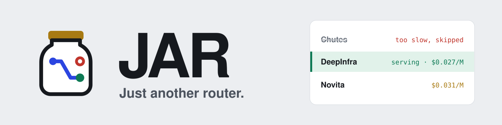

<p align="center">
  
</p>

<p align="center">
  <b>A self-hosted router for OpenRouter that sends every request to the cheapest provider that is actually up.</b>
</p>

<p align="center">
  <a href="https://github.com/Bohsauro/pennyroute/actions/workflows/ci.yml"></a>
  <a href="LICENSE"></a>
  
  
</p>

<p align="center">
  <a href="#quick-start">Quick start</a> ·
  <a href="#how-it-works">How it works</a> ·
  <a href="#use-it-as-your-endpoint">Use it</a> ·
  <a href="#configuration">Configuration</a> ·
  <a href="#deploying">Deploying</a> ·
  <a href="CONTRIBUTING.md">Contributing</a>
</p>

---

## Why

One model id on OpenRouter is usually hosted by many providers, and their prices for the same model can differ by 10× or more. The list price also hides what you really pay. In agent workloads most tokens are cache reads of a system prompt sent again every turn, so a provider that is cheap on input can still be the most expensive one for you.

JAR prices every provider on **your** token mix, drops the ones that are slow, flaky or over budget, and routes each request to the cheapest one left. If that provider fails, the next one answers and your client never notices.

## Features

- **Prices on your real traffic.** Every model × provider pair gets one number, dollars per million tokens, weighted by your input / cache-read / output split. The default mix (14% / 85% / 1%) comes from a measured agent workload. Providers that hide their cache price get a pessimistic estimate, marked `≈`.
- **Health gates.** A provider must reach 45 tokens/s and 99% uptime (both configurable) before it can be picked.
- **Fallback chains.** Ordered lists such as "free models first, then this model, then the cheapest paid one". JAR uses the first step that has a healthy provider.
- **Per-request failover.** If a provider errors, the request is retried on the next candidate.
- **OpenAI-compatible API.** `/v1/chat/completions` (streaming included) and `/v1/models`, with their own API keys. Works with the `openai` SDK, LangChain, Cursor, Aider, curl and anything else that speaks OpenAI.
- **Provider budgets.** Request, token or spend limits per provider, per day, month or in total. A provider that hits its limit, or that you block, is skipped automatically.
- **Full catalog.** Browse every OpenRouter model by tier, family and tag, and add models to your watchlist one at a time, from a preset, or as a whole filtered set.
- **Dashboard.** What is serving right now, the failover pipeline, the cost ranking with a per-provider breakdown, chain editor, budgets, API keys, a built-in chat and an event log.
- **No benchmark traffic.** Prices, throughput and uptime come from OpenRouter's live endpoint stats. No tokens are spent measuring anything.
- **Plain files.** All state is JSON in `data/`. No database, no frontend build step.

## Quick start

You need Python 3.10+ and an [OpenRouter API key](https://openrouter.ai/keys).

**One command** (creates a venv, asks for your key, registers a systemd service where available):

```bash
wget -qO- https://raw.githubusercontent.com/Bohsauro/pennyroute/main/install.sh | bash
```

**Docker:**

```bash
git clone https://github.com/Bohsauro/pennyroute.git && cd pennyroute
cp .env.example .env          # set OPENROUTER_API_KEY and PENNY_ADMIN_TOKEN
docker compose up -d
```

**Manual:**

```bash
git clone https://github.com/Bohsauro/pennyroute.git && cd pennyroute
python -m venv .venv && . .venv/bin/activate
pip install -r requirements.txt
cp .env.example .env          # set OPENROUTER_API_KEY
uvicorn pennyroute.app:app --host 0.0.0.0 --port 8490
```

Then open `http://localhost:8490` for the dashboard, or `http://localhost:8490/landing` for the project page.

## How it works

```
 watchlist ──▶ rank every model × provider ──▶ walk the primary chain ──▶ cheapest healthy provider
                · $/M on your token mix          top to bottom                   │
                · drop slow, down, over budget                                   ▼
                                                                   the request is served there;
                                                                   on error the next one retries
```

Every few minutes (5 by default) a background engine:

1. fetches pricing, throughput and uptime for every provider of the models on your watchlist;
2. computes each provider's blended price:

   ```
   blended $/M = in% · input price + cache% · cache-read price + out% · output price
   ```

3. drops providers under the health gates, over budget or blocked;
4. walks the primary chain and records the first healthy choice.

Requests to `/v1/chat/completions` are resolved the same way when they arrive.

## Use it as your endpoint

Create a key in the dashboard (**API endpoint → Create key**). It is shown only once.

```bash
curl http://localhost:8490/v1/chat/completions \
  -H "Content-Type: application/json" \
  -H "X-API-Key: pnk-YOUR-KEY" \
  -d '{"model": "penny", "messages": [{"role": "user", "content": "hello"}], "stream": true}'
```

```python
from openai import OpenAI

client = OpenAI(base_url="http://localhost:8490/v1", api_key="pnk-YOUR-KEY")
r = client.chat.completions.create(
    model="penny",
    messages=[{"role": "user", "content": "hello"}],
)
print(r.model)  # the model that actually answered
```

The `model` field picks the route:

| `model` | Routed to |
|---|---|
| `penny` | the primary chain |
| `penny:<chain>` | the chain with that name |
| any OpenRouter model id | that model, on its cheapest healthy provider |

Every response includes `pennyroute.served_by`: the model and provider that answered.

> **About the names:** the project was called PennyRoute before it became JAR. The `penny` model alias, the `pnk-` key prefix, the `PENNY_*` variables and the `pennyroute` package keep the old name, so existing clients and installs keep working.

## Fallback chains

A chain is an ordered list of steps in `data/chains.json`, edited visually in the **Fallback chains** tab.

| Step type | Meaning |
|---|---|
| `cheapest` | the cheapest healthy provider across the watchlist. Optional `filter` (for example `":free"`) and optional `providers` to restrict the pick |
| `model` | a fixed model. Optional `providers` list, tried in order; the step is skipped if none is available |

```json
{
  "name": "main",
  "primary": true,
  "auto_apply": true,
  "entries": [
    { "type": "cheapest", "filter": ":free" },
    { "type": "model", "model": "deepseek/deepseek-chat-v3", "providers": ["DeepInfra"] },
    { "type": "cheapest" }
  ]
}
```

The primary chain drives the `penny` alias and the engine. Other chains are available as `penny:<name>` and can be made primary with one click.

## Presets

One-click watchlists in the **Watchlist** tab, or `POST /api/presets/<name>`:

| Preset | For |
|---|---|
| `frugal` | cheap flash-class models for agents and coding |
| `balanced` | `frugal` plus mid-tier and coding models |
| `premium` | top models, still served by their cheapest healthy provider |
| `free` | `:free` variants only |

## Configuration

### Environment

| Variable | Default | Purpose |
|---|---|---|
| `OPENROUTER_API_KEY` | — | **Required.** Reads the catalog and forwards requests. |
| `PENNY_ADMIN_TOKEN` | unset | Password for the dashboard and `/api/*`. Without it they only answer to localhost. |
| `PENNY_RATE_LIMIT` | `120` | Max `/v1` requests per minute per client IP. `0` turns the limit off. |

The installer also reads `PENNY_PORT` (default `8490`) and `PENNY_INSTALL_DIR` (default `~/pennyroute`).

### Settings

Changed live in the **Settings** tab and stored in `data/settings.json`:

```json
{
  "mix": { "in": 0.14, "cache": 0.85, "out": 0.01 },
  "min_tps": 45,
  "min_uptime": 99.0,
  "interval_min": 5,
  "gateway_restart": true
}
```

To measure your own mix, export your OpenRouter activity CSV, add up input, cache-read and output tokens, and enter the percentages.

### Data files

| File | Contents |
|---|---|
| `data/models.json` | watchlist |
| `data/chains.json` | fallback chains |
| `data/settings.json` | token mix, health gates, interval |
| `data/keys.json` | `/v1` API keys, stored as SHA-256 hashes |
| `data/providers.json` | provider budgets, blocks and notes |
| `data/usage.json` | usage counters, written by the router |
| `data/telemetry.json` | routing snapshots for the 24 h trend |
| `data/events.jsonl` | append-only log of switches and errors |

Back up `data/`: it holds everything.

## Deploying

- **Local network or VPN.** JAR binds `0.0.0.0`, so it is reachable over LAN or Tailscale/WireGuard on port `8490`.
- **Remote access.** Set `PENNY_ADMIN_TOKEN` (the dashboard asks for it once) and put JAR behind a reverse proxy with HTTPS (Caddy, nginx, Cloudflare Tunnel). Never expose plain HTTP to the internet: API keys and the admin token travel in headers.
- **Behind a proxy on the same host**, run uvicorn with `--forwarded-allow-ips` set to the proxy address so rate limits see real client IPs. The Docker image already passes `--proxy-headers`.
- **Health check:** `GET /healthz`.

### Hermes Agent

If `~/.hermes` exists on the host, the engine writes the chosen model and provider order into `~/.hermes/config.yaml` and can restart the gateway (`gateway_restart`). Inside a container it only records telemetry. Chains start with `auto_apply` on: turn it off in the **Fallback chains** tab if you want to watch the **Events** log for a few cycles before JAR changes your agent's config.

## API reference

| Endpoint | Auth | Purpose |
|---|---|---|
| `POST /v1/chat/completions` | API key | OpenAI-compatible chat, streaming supported |
| `GET /v1/models` | API key | the `penny` aliases plus the watchlist |
| `GET /healthz` | none | liveness probe |
| `GET /api/rank` | admin | ranked watchlist with every provider |
| `GET /api/catalog` | admin | full OpenRouter catalog with filters and facets |
| `/api/chains` | admin | create, edit, delete chains and pick the primary |
| `/api/providers` | admin | budgets, blocks and usage |
| `/api/keys` | admin | create and revoke `/v1` API keys |
| `GET`, `PUT /api/settings` | admin | engine settings |
| `GET /api/events` | admin | event log |

The dashboard only uses these endpoints, so anything it does can be scripted.

## Project layout

```
pennyroute/            Python package (FastAPI backend)
  app.py               routes and static files
  router_proxy.py      /v1 proxy with per-request failover
  engine.py            background evaluation loop
  ranking.py           blended cost, health gates, chain resolution
  providers.py         provider budgets and usage counters
  orclient.py          OpenRouter client with caching
  security.py          admin token and rate limiting
  keys.py              API keys
  store.py             JSON state and presets
static/                dashboard and landing page (vanilla JS, no build)
docs/                  landing page for GitHub Pages
tests/                 regression tests
install.sh             one-command installer
Dockerfile, docker-compose.yml
```

## Development

```bash
pip install -r requirements.txt
uvicorn pennyroute.app:app --reload --port 8490
python -m unittest discover tests
```

There is no frontend build: edit `static/` and reload the page. Read [CONTRIBUTING.md](CONTRIBUTING.md) before opening a pull request.

## Roadmap

- [ ] Real spend tracking from the OpenRouter activity API
- [ ] Notifications (Slack, Telegram, Discord) when the route changes
- [ ] Backends beyond OpenRouter
- [x] Docker image
- [x] Provider budgets and usage tracking

## Security

Report vulnerabilities privately as described in [SECURITY.md](SECURITY.md), not in public issues.

## License

[MIT](LICENSE) © Bohsauro

JAR is not affiliated with OpenRouter. Prices and health data come from OpenRouter's public endpoint stats and can lag reality by a few minutes.
