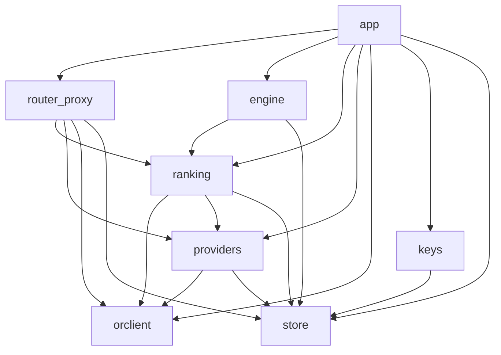
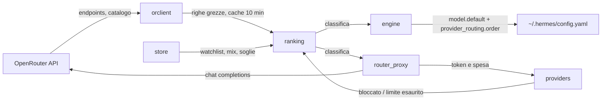

# Architettura

Un solo processo `uvicorn pennyroute.app:app` (porta 8490). Dentro ci sono tre cose:

1. **API + file statici** — [[app]] serve `/api/*`, `/v1/*` e la SPA.
2. **Proxy per richiesta** — [[router_proxy]] inoltra ogni chat completion a OpenRouter provando i candidati in ordine.
3. **Engine periodico** — [[engine]] è un thread daemon che ogni `interval_min` minuti risolve la catena primaria e, se è cambiata, riscrive `~/.hermes/config.yaml`.

Non c'è database: tutto lo stato è in `data/*.json` ([[File dati]]). La cache dei dati OpenRouter è solo in memoria ([[orclient]]).

## Dipendenze tra moduli

`store` e `orclient` sono le foglie: non importano nessun altro modulo del pacchetto. `providers` e `keys` importano da `store` anche i privati `_read_json` / `_write_json` e `DATA_DIR`.

## I due percorsi di routing

Entrambi partono dagli stessi dati (watchlist + endpoint OpenRouter + disponibilità provider) ma producono cose diverse.

| | Engine (periodico) | Proxy (per richiesta) |
|---|---|---|
| Codice | `engine.evaluate_primary` → `ranking.resolve_chain` | `router_proxy.proxy_chat` → `build_candidates` → `_forward` |
| Risultato | **una** coppia (modello, provider) | **lista ordinata** di candidati |
| Effetto | scrive `~/.hermes/config.yaml`, riavvia il gateway Hermes | inoltra la richiesta, passa al candidato successivo su errore |
| Catena usata | solo la primaria | primaria, una nominata (`penny:<nome>`), oppure un modello fisso |
| Registra usage | no | sì, `providers.record_usage` |

> [!warning] Logica duplicata
> `ranking.resolve_chain` e `router_proxy.build_candidates` camminano le catene con regole quasi identiche ma scritte due volte. Una modifica ai tipi di step va fatta in **entrambe**. Vedi [[Insidie note#Logica di catena duplicata]].

## Flusso dei dati

## Concorrenza

- Handler `def` sincroni: FastAPI li esegue nel threadpool.
- `v1_chat` è `async`, ma chiama codice bloccante (`build_candidates` → `rank_models` con `ThreadPoolExecutor(8)` e `urllib`). Vedi [[Insidie note#Chiamate bloccanti nell'event loop]].
- Lock: `store._lock` (Lock), `providers._lock` (RLock), `keys._lock` (Lock), `orclient._lock` (Lock). Sono indipendenti tra loro.
- Scritture JSON atomiche: file `.tmp` + `os.replace` (`store._write_json`).

Collegate: [[Flusso richiesta v1]], [[Concetti]], [[Convenzioni e vincoli]]
