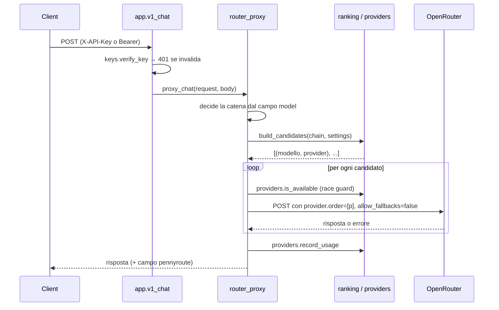

# Flusso di `POST /v1/chat/completions`



## 1. Autenticazione

`app._require_key` (`pennyroute/app.py:37`) legge `x-api-key` oppure `authorization`. [[keys]] toglie il prefisso `Bearer ` e confronta l'hash sha256.

## 2. Scelta della catena dal campo `model`

`router_proxy.proxy_chat` (`pennyroute/router_proxy.py:85`):

| Valore di `model` | Comportamento |
|---|---|
| `penny` | catena primaria |
| `penny:<nome>` | catena con quel nome; 404 se non esiste |
| nome esatto di una catena | quella catena (anche senza prefisso `penny:`) |
| qualsiasi altro id | *passthrough*: catena sintetica con un solo step `model` |
| vuoto, oppure modello senza candidati sani | ripiega in silenzio sulla catena primaria |

## 3. Costruzione dei candidati

`build_candidates` (`pennyroute/router_proxy.py:29`), per ogni step:

- `cheapest`: per ogni modello della classifica (dal più economico) aggiunge il suo endpoint migliore, se sano, disponibile e ammesso da `providers`. Quindi uno step `cheapest` produce **molti** candidati, uno per modello.
- `model` con `providers`: un candidato per ogni provider elencato che sia disponibile e sano, nell'ordine dato.
- `model` senza `providers`: tutti gli endpoint sani e disponibili, dal più economico.

Le coppie duplicate vengono scartate. Catena nominata senza candidati → `502 no healthy candidate in chain`.

## 4. Inoltro con failover

`_forward` (`pennyroute/router_proxy.py:125`), per ogni candidato:

1. **Race guard**: ricontrolla `providers.is_available`. Se nel frattempo è esaurito, logga `proxy_skip` e salta.
2. Copia il body, forza `model` e aggiunge `provider: {"order": [p], "allow_fallbacks": false}`.
3. Chiama `https://openrouter.ai/api/v1/chat/completions` con la chiave di `orclient.get_key()`. Timeout: 10 s connessione, 600 s lettura.
4. Status ≥ 400 o eccezione → candidato successivo.

Tutti falliti → evento `proxy_error` e `502 all chain candidates failed; last: …`.

### Non-streaming

Aggiunge alla risposta JSON:

```json
"pennyroute": {
  "served_by": "<modello> @ <provider>",
  "chain_tried": <numero candidati>,
  "provider_usage": { "requests": {"per", "pct", "remaining"}, ... }
}
```

e chiama `providers.record_usage(provider, modello, data["usage"])`.

### Streaming

Restituisce `StreamingResp` (sottoclasse di `StreamingResponse` che chiude il client httpx a fine stream). `_wrap_stream` inoltra i chunk intatti, tiene una coda di 64 KB in byte e a fine stream estrae l'ultimo oggetto `"usage"` con bilanciamento di graffe (`_usage_from_tail`). Nessun campo `pennyroute` viene iniettato nello stream.

> [!warning]
> Il failover in streaming avviene solo **prima** del primo byte: se il provider cade a metà stream, il client vede lo stream troncato.

Collegate: [[router_proxy]], [[providers]], [[API HTTP]]
